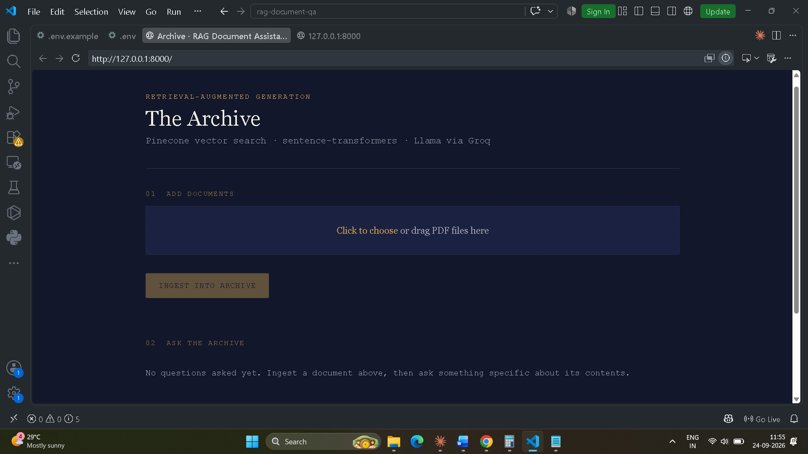

# RAG Document Q&A System

Ask questions about your PDF documents and get answers grounded in their content, with the source file and page cited for every answer.

**Stack:** Python · FastAPI · Pinecone · Sentence Transformers · Groq API (GPT-OSS 120B) · SQLite · Docker

**Results:** 95% retrieval hit rate · 85% fully correct answers · 5/5 correct refusals · 1.16 s median response time



---

## How it works

```
                 INGESTION                                      QUESTION ANSWERING
PDF upload                                       User question
   │                                                 │
   ▼                                                 ▼
Text extraction (pypdf, page by page)            Embed question (all-MiniLM-L6-v2)
   │                                                 │
   ▼                                                 ▼
Recursive chunking (500 chars, 50 overlap)       Pinecone similarity search (cosine, top-4)
   │                                                 │
   ▼                                                 ▼
Embeddings (all-MiniLM-L6-v2, 384-dim)           Prompt = retrieved chunks + question
   │                                                 │
   ▼                                                 ▼
Pinecone serverless index  ◄──────────────────   GPT-OSS 120B via Groq API
(text + file + page as metadata)                     │
                                                     ▼
                                         Grounded answer + [Source N] citations
                                         (declines if the answer is not in the documents)
                                                     │
                                                     ▼
                                         Logged to SQLite (question, answer, timing, sources)
```

## Features

- Upload one or more PDFs through the web page or the API
- Custom recursive character text splitter (paragraph → line → sentence → word)
- Semantic search over a Pinecone serverless index
- Answers restricted to the retrieved context, with file and page citations
- Re-uploading the same PDF overwrites its vectors instead of duplicating them (deterministic vector IDs)
- Every question is logged to SQLite with response times; `/api/stats` and `sql/analysis.sql` summarise usage
- Evaluation script that measures retrieval hit rate, correct refusals and response time
- Docker image ready for any container host; demo mode that disables public uploads

## Project structure

```
├── main.py                              FastAPI app: web page + REST API
├── pipeline.py                          Orchestrates ingestion and question answering
├── config.py                            Settings loaded from environment variables
├── ingest.py                            Command-line ingestion of a folder of PDFs
├── loaders/pdf_loader.py                PDF text extraction (pypdf)
├── splitters/text_splitter.py           Recursive character text splitter
├── embeddings/sentence_transformer.py   Embedding model wrapper
├── vectorstores/pinecone_store.py       Pinecone index: upsert + query
├── generators/groq_generator.py         Prompt building + Groq LLM call
├── storage/query_log.py                 SQLite query log
├── sql/analysis.sql                     Example SQL queries on the log
├── eval/evaluate.py                     Evaluation script
├── templates/index.html                 Web interface
├── Dockerfile
└── requirements.txt
```

## Setup

You need free API keys from [Pinecone](https://www.pinecone.io/) and [Groq](https://console.groq.com/keys).

```bash
git clone https://github.com/ruttvajrk/rag-document-qa.git
cd rag-document-qa
python -m venv .venv
source .venv/bin/activate        # Windows: .venv\Scripts\activate
pip install -r requirements.txt
cp .env.example .env             # Windows: copy .env.example .env
# open .env and add PINECONE_API_KEY and GROQ_API_KEY
```

## Run

```bash
uvicorn main:app --reload
```

Open http://localhost:8000, upload a PDF, then ask a question.

Or ingest a whole folder from the command line:

```bash
python ingest.py ./data
```

## Run with Docker

```bash
docker build -t rag-document-qa .
docker run -p 8000:8000 --env-file .env rag-document-qa
```

## API

| Method | Path | Body | Returns |
|---|---|---|---|
| GET | `/` | – | Web interface |
| POST | `/api/ingest` | multipart form, field `files` (PDFs) | files ingested, chunks indexed |
| POST | `/api/ask` | `{"question": "...", "top_k": 4}` | answer, sources, timing |
| GET | `/api/stats` | – | question count, average response times, most-retrieved documents |
| GET | `/api/health` | – | `{"status": "ok"}` |

Example:

```bash
curl -X POST http://localhost:8000/api/ask \
  -H "Content-Type: application/json" \
  -d '{"question": "What is the procedure for escalating a grievance?"}'
```

## Example questions and answers

### Q1: What is the procedure for escalating a grievance that is not resolved in time?

**Answer:**
If a grievance is not resolved to the employee's satisfaction, the employee may appeal the decision to the appellate authority (the BU CEO or Station Head) within 30 days of the GRC's decision [Source 1].

The appellate authority must then consult with the BU HR-Head and the BU-GRC Secretary before making a final determination. This appeal process must be completed within 14 working days from the date the employee raises the case before the appellate authority [Source 1].

The decision of the appellate authority is binding and final on all parties [Source 3].

**Sources:** `grievance_policy.pdf`, page 13 · answered in 1.99 s

### Q2: How do I file an RTI application, and what is the fee?

**Answer:**
1. **Write the application**, addressed to the Public Information Officer (PIO) of the concerned public authority. It can be in English, Hindi or the official language of the area. The request should be precise and specific, and the fee must be paid at the time of submitting the application, as prescribed in the fee rules [Source 1].
2. **Pay the prescribed fee** to the Accounts Officer (or the Assistant Public Information Officer) of the public authority. Payment can be made in cash or by other modes allowed under the rules, and you should get a receipt. The exact amount and mode of payment depend on the rules issued under Sections 27 and 28 of the RTI Act, 2005 [Source 4].

**Sources:** `rti_faq_2012.pdf`, pages 2–4 · answered in 2.15 s

## Evaluation

Test set: 25 hand-written questions on 2 public PDFs (an HR grievance policy and an RTI FAQ; 19 pages, 88 chunks). 20 are answerable from the documents and 5 are not.

| Metric | Result |
|---|---|
| Retrieval hit rate (expected page in top-4) | 19/20 (95%) |
| Answers fully correct (manually checked) | 17/20 (85%) |
| Correct refusals on out-of-document questions | 5/5 |
| Median / average response time | 1.16 s / 1.81 s (retrieval 0.57 s + generation 1.25 s) |

Response times measured on an Intel Core i5-10300H CPU (2.50 GHz) with 8 GB RAM.

**Errors found:** the model once misread an exclusion list (answered that promotions are covered when the policy excludes them), and once retrieval returned a general rule instead of a specific exception on another page. One answer was incomplete.

**Model change:** Groq retired `llama-3.3-70b-versatile` in August 2026; the app now uses `openai/gpt-oss-120b`, set via `GROQ_MODEL` in `.env`.

### Run the evaluation yourself

1. Copy `eval/questions_template.csv` to `eval/questions.csv`.
2. Add questions with known answers (`in_doc`, with the expected file and page) and questions the documents do not cover (`out_of_doc`).
3. Start the app, then run:

```bash
python eval/evaluate.py --url http://localhost:8000 --questions eval/questions.csv
```

## Query log (SQL)

```bash
sqlite3 logs/query_log.db < sql/analysis.sql
```

## Deployment

The Docker image runs on any container host. Set `PINECONE_API_KEY` and `GROQ_API_KEY` as secrets on the host, never inside the image. For a public demo, set `ALLOW_UPLOADS=false` and ingest the sample PDFs with `python ingest.py` before starting.

## Known limitations

- Scanned PDFs (images without a text layer) are skipped; no OCR.
- If a PDF is edited and re-uploaded with fewer chunks, old extra chunks stay in the index.
- The SQLite log lives inside the container and is lost when it restarts, unless a volume is mounted.